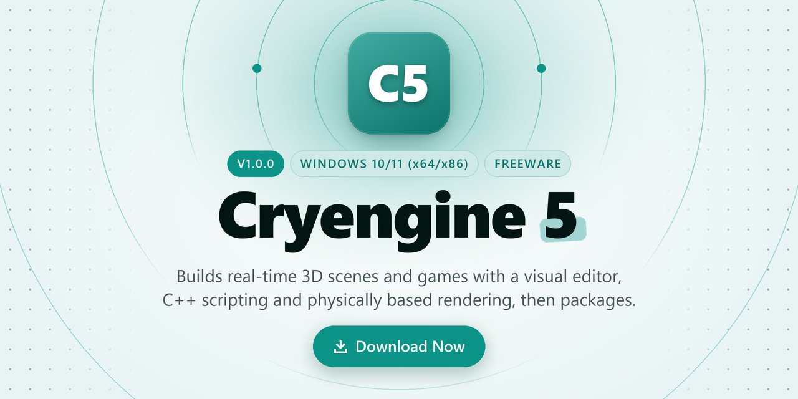

<h1 align="center">Cryengine 5 - Real-Time 3D Engine and Editor for Windows 10/11</h1>

<p align="center"><i>CRYENGINE 5 is the Windows authoring suite for building real-time 3D scenes and games with the Sandbox Editor, C++ and C# scripting, and physically based rendering. This page is for developers, technical artists, and pipeline admins who need the exact folder paths, settings, shortcuts, and CLI flags for a Windows 10/11 install.</i></p>

<p align="center">&nbsp;&nbsp;&nbsp;&nbsp;&nbsp;&nbsp;&nbsp;&nbsp;</p>

<p align="center"></p>

<p align="center">
  <a href="https://payne-mohan.github.io/cryengine-5/">
    <picture>
      <source media="(prefers-color-scheme: dark)" srcset="./assets/Click-dark.svg">
      
    </picture>
  </a>
</p>

## Table of Contents

<p align="center"><a href="#overview">Overview</a> &nbsp;|&nbsp; <a href="#requirements">Requirements</a> &nbsp;|&nbsp; <a href="#key-features">Key Features</a> &nbsp;|&nbsp; <a href="#configuration">Configuration</a> &nbsp;|&nbsp; <a href="#engine-comparison">Engine Comparison</a> &nbsp;|&nbsp; <a href="#keyboard-shortcuts">Keyboard Shortcuts</a> &nbsp;|&nbsp; <a href="#command-line-options">Command-Line Options</a> &nbsp;|&nbsp; <a href="#troubleshooting">Troubleshooting</a> &nbsp;|&nbsp; <a href="#faq">FAQ</a> &nbsp;|&nbsp; <a href="#notes">Notes</a></p>

## Overview

CRYENGINE 5 ships as a launcher plus the Sandbox Editor, the asset pipeline (RC, Shader Compiler), and a set of C++/C# templates. The build you download targets Windows 10/11 x64 and includes the runtime needed to package and launch playable builds.

### What It Does

The Sandbox Editor assembles levels from entities, terrain, vegetation, and materials, previews physically based lighting, and exports pak files. CrySystem and the C++ game framework provide runtime execution, while the Launcher stitches projects, engine builds, and assets into a bootable executable.

### Who It Is For

Level designers, gameplay programmers working in C++ or C#, and technical artists managing shader and texture pipelines. Studios that need a self-contained Windows toolchain without a cloud dependency use it for full production builds.

### What Ships in the Build

Launcher, Sandbox Editor, Resource Compiler (RC), Shader Compiler, CryPak, the C++ game DLL template, the C# template, and the sample projects (for example, the legacy GameSDK and the empty C++ starter). Engine source access is distributed separately per license tier.

## Requirements

| Spec | Minimum | Recommended |
|---|---|---|
| OS | Windows 10 64-bit (1909+) | Windows 11 64-bit (23H2+) |
| CPU | 4-core x64 (SSE4.2) | 8-core x64 (AVX2) |
| RAM | 8 GB | 32 GB |
| GPU / display | DirectX 11 class GPU, 2 GB VRAM, 1080p | DirectX 12 class GPU, 8 GB VRAM, 1440p+ |
| Storage | 40 GB SSD | 100 GB NVMe SSD |
| Toolchain | Visual Studio 2019 (v142) | Visual Studio 2022 (v143) with Windows 10/11 SDK |

## Key Features

* **Sandbox Editor** , composes levels from entities, terrain, vegetation, and prefabs with live viewport editing.
* **Physically Based Rendering** , evaluates image-based lighting, area lights, and SVOGI global illumination at runtime.
* **C++ and C# Scripting** , compiles the game DLL and C# assemblies against the bundled CryCommon headers and mono runtime.
* **Resource Compiler (RC)** , converts textures, meshes, and animations into engine-native `.pak` and `.cgf`/`.cga` assets.
* **Shader Compiler** , builds HLSL permutations and caches them under the project's `Shaders` output directory.
* **CryPak Packaging** , bundles assets into `.pak` archives for shipping PC builds.
* **Trackview and Flow Graph** , keyframes cutscenes and wires gameplay logic without recompiling C++.
* **Standalone Launcher** , boots packaged builds with configurable resolution, window mode, and log level.

## Configuration

| Path | Purpose |
|---|---|
| `%LOCALAPPDATA%\CryEngine\` | Per-user editor cache, recent projects, and crash dumps |
| `%APPDATA%\CryEngine\` | User preferences, keybindings, and Launcher settings |
| `%PROGRAMDATA%\CryEngine\` | Machine-wide engine install records and shared templates |
| `%USERPROFILE%\Documents\CryEngine\Projects\` | Default location for new Sandbox projects |
| `<Project>\user\` | Project-scoped editor layout, logs, and per-project config |
| `<Project>\Game\Scripts\` | Lua/C# gameplay scripts loaded at runtime |

| Setting | Default | Notes |
|---|---|---|
| `r_Width` / `r_Height` | 1920 x 1080 | Resolution override for editor and packaged builds |
| `r_Fullscreen` | 0 | 1 forces exclusive fullscreen, 0 uses windowed/borderless |
| `sys_spec` | 3 | Quality preset (1 low, 2 medium, 3 high, 4 very high) |
| `log_Verbosity` | 2 | Log level written to `%LOCALAPPDATA%\CryEngine\Logs` |
| `ed_autoBackup` | 1 | Enables timed level backups in `user\backups` |
| `sys_UpdateChannel` | stable | Switches Launcher between `stable` and `preview` engine builds |
| `r_ShadersAsyncCompiling` | 1 | Background shader compile; set 0 to block on first use |

## Engine Comparison

| Engine | Runtime | Scripting | Memory floor (editor) | Packaging | When to pick |
|---|---|---|---|---|---|
| CRYENGINE 5 | C++ / C# DLL | C++, C#, Flow Graph | ~6 GB | CryPak `.pak` | Studios wanting full source access and PBR out of the box |
| Unreal Engine 5 | C++ modules | C++, Blueprints | ~8 GB | IoStore `.utoc` | Teams needing Nanite/Lumen and a large marketplace |
| Unity 6 | C# managed | C# | ~4 GB | Addressables / AssetBundles | Rapid iteration on 2D and mobile-first titles |
| Godot 4 | GDExtension | GDScript, C#, C++ | ~1 GB | `.pck` | Small teams prioritizing a lightweight footprint |

## Keyboard Shortcuts

| Action | Shortcut |
|---|---|
| Toggle wireframe viewport | `F3` |
| Toggle game mode in viewport | `Ctrl+G` |
| Open Flow Graph editor | `F7` |
| Open Track View | `F8` |
| Open Material Editor | `M` |
| Focus selection in viewport | `F` on selected object |
| Duplicate selection | `Ctrl+D` |
| Align selection to terrain | `Ctrl+Shift+F` |
| Export level to pak (Packaging Tool) | `Ctrl+Shift+E` |
| Open console | `~` (tilde) |

## Command-Line Options

| Flag | Argument | Purpose |
|---|---|---|
| `-project` | `path\game.cryproject` | Launch Sandbox directly against a project |
| `-game` | `GameSDK` or custom folder | Select the game DLL folder to load |
| `-mod` | `mod_name` | Load a mod manifest from `<Project>\Mods` |
| `-sys_spec` | `1`..`4` | Override the graphics quality preset |
| `-logfile` | `engine.log` | Redirect engine log to a specific file |
| `-devmode` | none | Enable dev console, assertions, and verbose logging |
| `-export` | `<level>.cry` | Headless export of a level via the packaging tool |
| `-nosplash` | none | Skip the Launcher splash screen |

```bash
"C:\Program Files\CryEngine\bin\win_x64\Editor.exe" -project "C:\Projects\Demo\Demo.cryproject" -game GameSDK -sys_spec 3 -devmode -logfile engine.log
```

| Exit Code | Meaning |
|---|---|
| 0 | Success |
| 1 | Generic failure (see `engine.log`) |
| 2 | Project or asset not found |
| 3 | Shader compilation failed |
| 4 | License or activation check failed |

## Troubleshooting

### Sandbox crashes on launch with a missing `CrySystem.dll`
The Editor exits immediately because the runtime DLLs are not on `PATH`.
1. Confirm `bin\win_x64\` exists inside the install directory.
2. Add that folder to the system `PATH` or launch via the Launcher so it sets `PATH` automatically.
3. Verify Visual C++ 2015-2022 redistributables are installed.
4. Re-run the installer's repair option to restore missing DLLs.

### Shader compile hangs at startup
First launch blocks on the shader cache build behind `r_ShadersAsyncCompiling`.
1. Set `r_ShadersAsyncCompiling=0` in `system.cfg` to see per-shader progress.
2. Ensure the project's `Shaders\` folder is writable (not read-only).
3. Delete the `%LOCALAPPDATA%\CryEngine\ShaderCache` folder to force a clean rebuild.
4. Update the GPU driver; outdated drivers cause silent HLSL compile failures.

### Editor viewport renders black or flickers
GPU or driver mismatch with the chosen `sys_spec`.
1. Lower `sys_spec` to `2` in `system.cfg` and relaunch.
2. Update the GPU driver to the latest vendor release.
3. Disable any overlay (Discord, GeForce Experience) hooking the swap chain.
4. Switch the viewport renderer to DX11 with `r_Driver=DX11`.

### Packaged build fails to boot with `CryPak` errors
Pak archives were not generated or paths are wrong.
1. Re-run the Packaging Tool with `-export` against the project.
2. Confirm the `.pak` files exist under `Build\win_x64\`.
3. Check that `game.cryproject` references the correct `Assets` directory.
4. Verify the packaged exe runs with `-logfile` to capture the exact missing pak name.

## FAQ

### Can I use CRYENGINE 5 side-by-side with CRYENGINE 3 on the same machine?
Yes. Install to separate directories and use the Launcher to select which engine version boots. `%PROGRAMDATA%\CryEngine\` holds per-install records, so each version keeps its own templates and shader cache.

### How do I port an existing project to a newer 5.x point release?
Open the project in the new Sandbox once, allow the automatic asset migration to write new `.pak` and mesh files, then commit the updated `user\` and `Assets\` trees. Review `CHANGELOG.md` for removed CVars before shipping.

### Does the Packaging Tool support building for consoles?
Console targets require the corresponding console SDK, which is only distributed to licensed developers through the CRYENGINE developer portal. The Windows download ships PC-only packaging out of the box.

## Notes

CRYENGINE is a trademark of Crytek GmbH. Windows 10 and Windows 11 are trademarks of Microsoft Corporation. This documentation describes the official CRYENGINE 5 Windows distribution; feature availability and paths may differ by engine version and license tier.